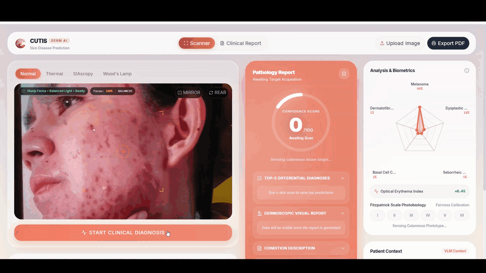
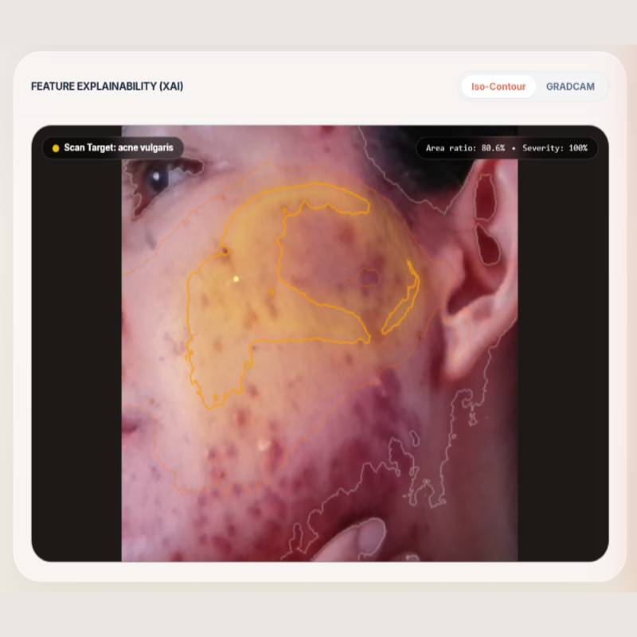
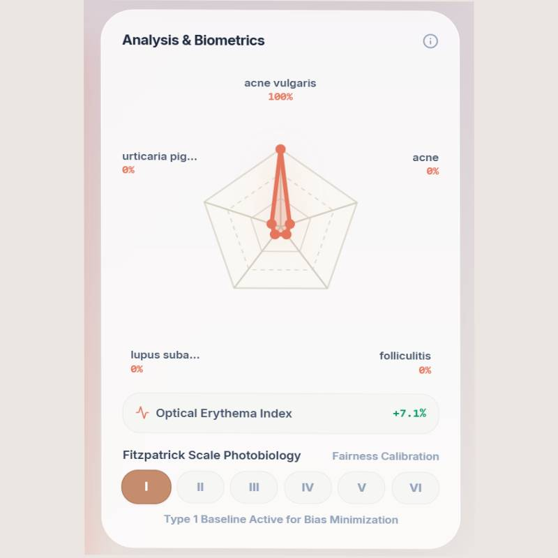
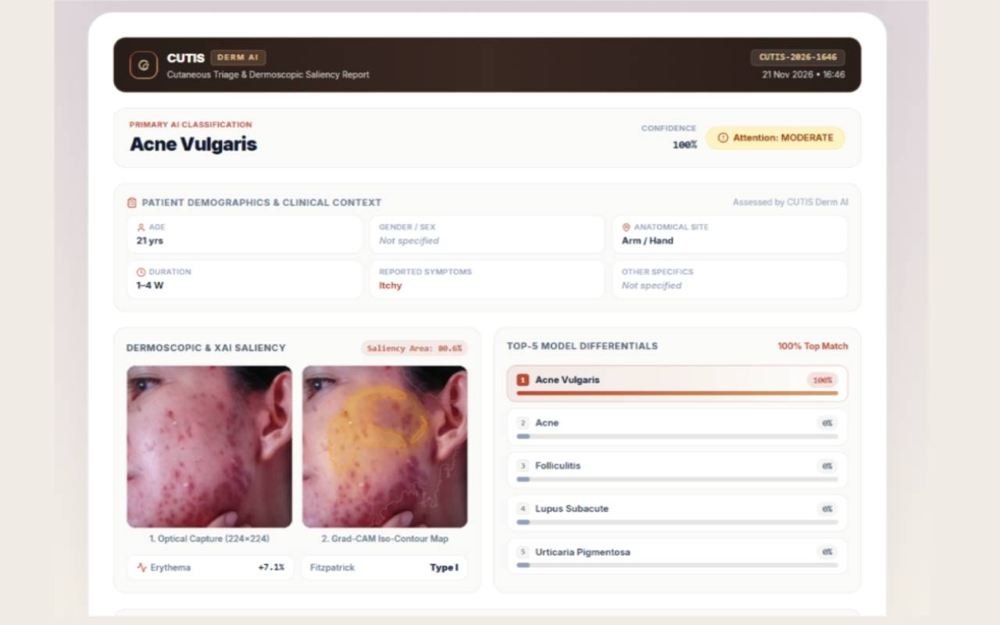

<div align="center">
  
  <h1>CUTIS DERM AI</h1>
  <p><strong>Cutaneous Triage, Optical Saliency &amp; VLM Clinical Reporting Platform</strong></p>
</div>

> **Clinical Decision-Support Notice:** CUTIS DERM AI is developed strictly for preliminary screening, triage support, and educational purposes. It is not a certified medical device and does not provide definitive medical diagnoses. All findings must be confirmed through an in-person examination by a qualified dermatologist or healthcare professional.

---

## Table of Contents

- [Overview](#overview)
- [Walkthrough & Interface Preview](#walkthrough--interface-preview)
- [Key Features](#key-features)
- [System Architecture & Tech Stack](#system-architecture--tech-stack)
- [Project Structure](#project-structure)
- [Getting Started](#getting-started)
  - [Prerequisites](#prerequisites)
  - [Frontend Installation](#frontend-installation)
  - [Backend & VLM API Setup](#backend--vlm-api-setup)
- [Clinical Disclaimer](#clinical-disclaimer)
- [License](#license)

---

## Overview

**CUTIS DERM AI** is a full-stack dermatological screening workstation that combines real-time edge computer vision with Vision-Language Model (VLM) clinical synthesis. By running neural network classification and Grad-CAM saliency localization directly in the browser via ONNX Runtime Web, the platform delivers low-latency visual feedback while integrating patient context and cutaneous biometrics into structured, print-ready clinical triage reports.

---

## Walkthrough & Interface Preview

### End-to-End Application Walkthrough


*Placeholder: Replace `docs/assets/walkthrough.gif` with a screen recording demonstrating live capture, saliency overlay inspection, patient context entry, VLM report generation, and A4 PDF export.*

### Interface Screenshots

| Scanner Workstation | Analysis & Biometrics Panel |
| :---: | :---: |
|  
|  |
| *Live optical feed, quality gate telemetry, and Top-5 differential predictions.* | *5-axis spider radar, Erythema Index, Fitzpatrick baseline, and demographic inputs.* |

| Clinical Triage Report (A4 Print Layout) |
| :---: |
|  |
| *Multi-page A4 report featuring Grad-CAM iso-contours, ICD-10 context, and care guidance.* |

---

## Key Features

### 1. Optical Capture & Pre-Inference Quality Gate
- **Dual Input Modes:** Supports real-time webcam/dermatoscope streaming (optimized at 720p @ 30fps) as well as high-resolution local image uploads.
- **Automated Frame Validation:** Evaluates sharpness (Laplacian variance), specular glare, and luminance levels prior to inference to prevent degraded or out-of-focus captures from skewing predictions.

### 2. Edge AI Classification & Explainability (XAI)
- **In-Browser Inference:** Executes an EfficientNet-B0 ONNX model directly on the client using ONNX Runtime Web with automatic WebGL and WASM fallbacks.
- **Top-5 Differential Ranking:** Displays calibrated confidence scores across the top five candidate classifications alongside a 5-axis spider radar chart.
- **Grad-CAM Iso-Contour Saliency:** Generates spatial activation overlays highlighting the active lesion region and computes the Active Saliency Area ratio.

### 3. Cutaneous Biometrics & Patient Context
- **Optical Erythema Index:** Quantifies localized vascular redness relative to surrounding perilesional skin.
- **Fitzpatrick Phototype Baseline:** Estimates baseline skin phototype (Types I–VI) to support fairness calibration and bias minimization.
- **Structured Patient Profiling:** Captures anatomical site, lesion duration, symptomatic indicators (pruritus, tenderness, bleeding/oozing, size change), and optional demographics (age, sex, and clinical history notes).

### 4. VLM Clinical Synthesis & A4 PDF Export
- **Structured Narrative Generation:** Synthesizes classifier probabilities, biometrics, and patient context via a FastAPI + Groq VLM (`qwen/qwen3.8-27b`) pipeline into structured dermoscopic observations, ICD-10 overviews, care guidance, and urgency-graded next steps.
- **Print-Optimized Reporting:** Includes a dedicated `@media print` A4 stylesheet that formats findings into a clean, multi-page clinical brief with exact color preservation and one-click plain-text copying.

---

## System Architecture & Tech Stack

```text
+-------------------------------------------------------------------+
|                        FRONTEND (React + Vite)                    |
|                                                                   |
|  [Camera / Upload] ---> [CV Quality Gate] ---> [ONNX Runtime Web] |
|                                                       |           |
|  [A4 Clinical Report] <--- [Biometrics & Context] <---'           |
+-----------------------------------+-------------------------------+
                                    | HTTPS / JSON Payload
                                    v
+-------------------------------------------------------------------+
|                     BACKEND API (Python + FastAPI)                |
|                                                                   |
|  [/clinical-report] ---> [Prompt & Token Guard] ---> [Groq VLM]   |
+-------------------------------------------------------------------+
```

- **Frontend:** React, TypeScript, Vite, Tailwind CSS v4, Lucide React
- **Client Inference:** ONNX Runtime Web (`onnxruntime-web`), HTML5 Canvas & WebGL2
- **Backend Service:** Python 3.10+, FastAPI, Pydantic, Groq Python SDK (`qwen/qwen3.8-27b`)

---

## Project Structure

```text
cutis-derm-ai/
├── docs/
│   └── assets/                  # Logo, UI screenshots, and walkthrough GIF
├── public/
│   └── models/                  # EfficientNet-B0 ONNX model weights
├── src/
│   ├── components/
│   │   ├── BiometricsPanel.tsx  # 5-axis radar, erythema index, Fitzpatrick & patient inputs
│   │   ├── Header.tsx           # Responsive workspace navigation & quick actions
│   │   └── ReportView.tsx       # Clinical narrative & A4 print-formatted report sheet
│   ├── services/
│   │   └── groqVlmService.ts    # Backend API client for VLM clinical synthesis
│   ├── types/
│   │   └── clinical.ts          # Shared TypeScript interfaces and clinical constants
│   ├── App.tsx                  # Main application state & camera/inference pipeline
│   └── index.css                # Brand palette variables & @media print rules
├── backend/
│   └── app.py                   # FastAPI server & Groq VLM /clinical-report endpoint
└── package.json
```

---

## Getting Started

### Prerequisites

- **Node.js** `v18.0` or higher
- **Python** `3.10` or higher (for the FastAPI VLM reporting backend)
- **Groq API Key** (for generating detailed VLM clinical narratives)

### Frontend Installation

1. Clone the repository and install dependencies:
   ```bash
   git clone https://github.com/your-username/cutis-derm-ai.git
   cd cutis-derm-ai
   npm install
   ```

2. Configure the backend endpoint in a `.env` file at the project root:
   ```env
   VITE_API_BASE_URL=http://localhost:8000
   ```

3. Start the development server:
   ```bash
   npm run dev
   ```

### Backend & VLM API Setup

1. Navigate to your backend directory and install required Python packages:
   ```bash
   cd backend
   pip install fastapi uvicorn pydantic groq
   ```

2. Set your Groq API key as an environment variable:
   ```bash
   export GROQ_API_KEY="your_groq_api_key_here"
   ```

3. Launch the FastAPI server:
   ```bash
   uvicorn app:app --host 0.0.0.0 --port 8000 --reload
   ```

---

## Clinical Disclaimer

This software and its generated outputs are intended solely for research, educational demonstration, and preliminary triage support. Automated classifications, saliency maps, and VLM-generated narratives may contain inaccuracies and must never be used as a substitute for professional medical advice, diagnosis, or treatment.

---

## License

Distributed under the MIT License. See `LICENSE` for more information.